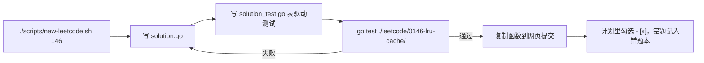

# Go 环境搭建

> 配合 [G1 环境、模块与工具链](../../notes/go/01-toolchain-modules.md) 使用。目标：在你自己的电脑（Ubuntu）和实验虚拟机（RHEL 10）上都能 `go build`，并且能本地写 LeetCode 题解、跑测试。
>
> 写作时 Go 最新稳定版是 **1.27**（2026 年 8 月发布，见 [`references/go/go-docs/go1.27.md`](../../references/go/go-docs/go1.27.md)）；仓库里的 [`go/go.mod`](../../go/go.mod) 要求 Go ≥ 1.24，但 CKA 阶段要用的新版依赖（client-go v0.37、controller-runtime v0.25、x/crypto v0.58、Prometheus client_golang v1.25）都要求 Go ≥ 1.26，所以**建议直接装最新稳定版**，不要用发行版仓库里偏旧的版本。

## 1. 装在哪台机器上

| 机器 | 要不要装 | 用途 |
|---|---|---|
| 你的电脑（Ubuntu / macOS / Windows） | **必装** | 日常写代码、刷题、跑测试、交叉编译 |
| RHCE 实验的控制节点 | 建议装 | 直接在实验环境里跑 P6 gossh 等需要连受管节点的工具 |
| 受管节点、CKA 集群节点 | 不用装 | Go 编译出来是静态二进制，`scp` 过去就能跑；部署到集群时打成镜像 |

交叉编译：在电脑上编出 RHEL 能直接运行的二进制。`CGO_ENABLED=0` 保证不依赖 glibc 版本：

```bash
CGO_ENABLED=0 GOOS=linux GOARCH=amd64 go build -o bin/logstat ./tools/logstat
```

Apple Silicon 的 UTM 虚拟机是 aarch64，把 `GOARCH=amd64` 换成 `GOARCH=arm64`。

## 2. 在 RHEL 10 上安装：两种方式

| | 方式 A：`dnf install golang` | 方式 B：官方 tarball |
|---|---|---|
| 版本 | 跟随 RHEL 的 AppStream，通常比最新版晚，具体以 `dnf info golang` 为准 | 想用哪个版本就装哪个，和 go.dev 同步 |
| 更新 | `dnf update` 一起更新，有红帽安全补丁 | 手动下载替换 |
| 适合 | 实验 VM、想和系统包管理保持一致 | 你的电脑、需要新语言特性的时候 |
| RHCSA 关联 | 正好练习 [dnf 与仓库](../../notes/rhcsa/06-software-scheduling-boot.md) | 正好练习 tar、PATH、`/etc/profile.d` |

### 方式 A：dnf

```bash
sudo dnf install -y golang
```

```bash
go version
```

红帽打包的 Go 带有 FIPS 相关补丁，日常学习没有区别；版本号以 `go version` 的实际输出为准。

### 方式 B：官方 tarball

在 [go.dev/dl](https://go.dev/dl/)（国内镜像 [golang.google.cn/dl](https://golang.google.cn/dl/)）找到最新的 `linux-amd64.tar.gz`，把下面的版本号换成实际版本：

```bash
curl -LO https://go.dev/dl/go1.27.0.linux-amd64.tar.gz
```

先删掉旧版本再解压（官方文档的要求：不要解压到已有的 /usr/local/go 上）：

```bash
sudo rm -rf /usr/local/go && sudo tar -C /usr/local -xzf go1.27.0.linux-amd64.tar.gz
```

让所有用户的 PATH 都包含 Go。`$HOME/go/bin` 是 `go install` 装工具的位置：

```bash
echo 'export PATH=$PATH:/usr/local/go/bin:$HOME/go/bin' | sudo tee /etc/profile.d/go.sh
```

重新登录，或执行 `source /etc/profile.d/go.sh`，然后验证：

```bash
go version
```

## 3. 在 Ubuntu 上安装

Ubuntu 仓库里的 `golang-go` 往往比较旧，推荐和上面方式 B 一样用官方 tarball，命令完全相同。只想快速装一个也可以用 snap（版本以 snap 为准）：

```bash
sudo snap install go --classic
```

## 4. 国内网络：模块代理

`go get`、`go mod tidy` 默认从 `proxy.golang.org` 下载依赖，国内经常超时。设置国内代理（写入 `go env` 的配置文件，永久生效）：

```bash
go env -w GOPROXY=https://goproxy.cn,direct
```

- `goproxy.cn` 是七牛云维护的公共代理；也可以用 `https://mirrors.aliyun.com/goproxy/`。`direct` 表示代理里没有时直接回源。
- **校验和数据库 GOSUMDB**：默认是 `sum.golang.org`，用来校验下载的模块没被篡改。不要关掉它（不要设成 `off`）。goproxy.cn 支持代理校验和数据库的请求；如果校验仍然超时，可以改用官方的国内地址 `go env -w GOSUMDB=sum.golang.google.cn`。这一项以官方文档为准。
- 公司内部的私有模块（比如内部 GitLab）用 `GOPRIVATE` 声明，不走代理也不做公共校验：`go env -w GOPRIVATE=gitlab.example.internal`。

查看当前生效的设置：

```bash
go env GOPROXY GOSUMDB GOPRIVATE GOPATH GOTOOLCHAIN
```

### GOTOOLCHAIN：别被自动下载吓到

从 Go 1.21 开始，如果某个项目的 `go.mod` 要求的 Go 版本比你装的新，`go` 命令会自动下载对应的工具链。在没网的实验 VM 上想禁止这个行为：

```bash
go env -w GOTOOLCHAIN=local
```

## 5. 编辑器：VS Code + Go 扩展

1. 安装 VS Code，在扩展市场装 **Go**（发布者是 Go Team at Google）。
2. 命令面板（Ctrl+Shift+P）执行 **Go: Install/Update Tools**，全选安装。核心是这两个：
   - **gopls**：官方语言服务器，提供补全、跳转、重命名、保存时自动 `gofmt`；
   - **dlv**（Delve）：调试器，可以下断点调试 LeetCode 题和工具。

也可以用命令行安装（装到 `$HOME/go/bin`）：

```bash
go install golang.org/x/tools/gopls@latest
```

```bash
go install github.com/go-delve/delve/cmd/dlv@latest
```

3. 用 VS Code 打开整个仓库即可：仓库的 Go 代码都在 [`go/`](../../go/) 这个 module 里。如果 gopls 提示找不到 module，就单独打开 `go/` 目录，或在仓库根目录执行 `go work init ./go`（`go.work` 只是本机配置，可以不提交）。

用 vim 的话，`gopls` 同样可以通过 vim-lsp / coc.nvim 接入；vim 的基础配置见 [F7](../../notes/00-foundations/07-vim-tmux-exam-efficiency.md)。

## 6. 验证：跑通仓库里的示范

```bash
cd go && go test ./leetcode/... -v
```

看到 `--- PASS: TestTwoSum` 就说明环境没问题。再写一个最小的 hello：

```bash
mkdir -p /tmp/hello && cd /tmp/hello && go mod init example.com/hello
```

```bash
printf 'package main\n\nimport (\n\t"fmt"\n\t"os"\n)\n\nfunc main() {\n\th, _ := os.Hostname()\n\tfmt.Println("hello from", h)\n}\n' > main.go && go run .
```

自检清单：

- [ ] `go version` 输出 ≥ 1.26（推荐最新稳定版 1.27.x）
- [ ] `go env GOPROXY` 是你设置的代理
- [ ] `go test ./leetcode/...` 通过
- [ ] VS Code 里打开 `solution.go`，鼠标悬停能看到函数说明，保存会自动格式化
- [ ] 能交叉编译出 linux/amd64 二进制，并 `scp` 到 RHEL 虚拟机上运行

## 7. LeetCode 准备

- **账号**：[力扣 leetcode.cn](https://leetcode.cn/) 和 [LeetCode leetcode.com](https://leetcode.com/) 的题号完全一致，计划里两个链接都给了，选一个注册即可。国内访问 leetcode.cn 更快，也有中文题面和题解。
- **在线编辑器的 Go 版本**：以题目页面「语言」下拉框或提交说明里显示的为准，可能比你本地的版本旧。太新的语法（比如刚发布的标准库函数）提交前留意一下。
- **并发题**：比如 1114 按序打印，LeetCode 不一定提供 Go 选项。以题目页面为准；不支持时就在本地实现，用 `go test -race` 验证。
- **会员题**：计划里标 🔒 的需要会员，全部是可选题。

### 本地刷题工作流



详细的目录约定和命令见 [`go/leetcode/README.md`](../../go/leetcode/README.md)，题单见 [`leetcode-plan.md`](leetcode-plan.md)。

## 8. 常见问题

| 现象 | 原因与处理 |
|---|---|
| `go: command not found` | PATH 没生效：重新登录，或 `source /etc/profile.d/go.sh` |
| `go mod tidy` 卡住或 `i/o timeout` | 没设模块代理，见第 4 节 |
| `verifying module: ... checksum mismatch` | 本地缓存损坏或代理返回异常：`go clean -modcache` 后重试；不要用关掉 GOSUMDB 的办法绕过 |
| `go: downloading go1.xx` 然后失败 | 某个 go.mod 要求更新的 Go，见 GOTOOLCHAIN 一节 |
| VS Code 不补全 | 看右下角 gopls 是否在运行；执行 **Go: Install/Update Tools** |
| 交叉编译的二进制在 RHEL 上报 `GLIBC_x.xx not found` | 编译时没加 `CGO_ENABLED=0` |
