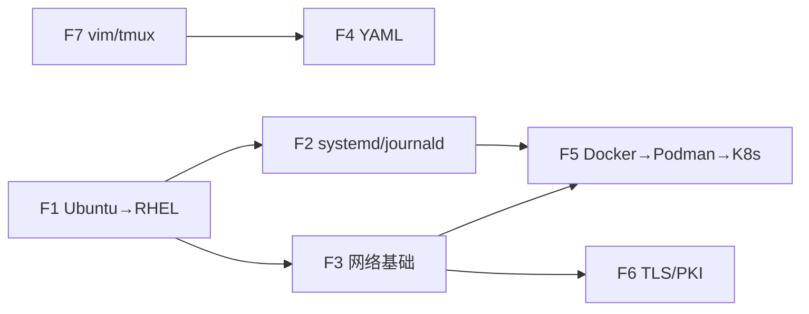

# 00 · 公共基础（Foundations）

> 返回 [知识网络总览](../README.md) ｜ 下一站：[RHCSA 轨道](../rhcsa/README.md)

这 7 个节点不对应某一门考试的某一条考纲，而是**三门考试共同依赖的底座**。
它们专门为「用过 Ubuntu 和 docker/compose、没碰过 RHEL」的背景设计：每篇都先讲「你熟悉的 X ≈ 这里的 Y」，再讲考试要用到的部分。
总投入约 **20 小时**，建议在开始 RHCSA 之前的 1~2 周内完成（F6 可以推迟到 CKA 阶段前再读）。

## 节点与建议顺序

| 顺序 | 节点 | 建议用时 | 什么时候读 |
|---|---|---|---|
| 1 | [F1 Ubuntu → RHEL 对照](01-ubuntu-to-rhel.md) | 3 h | 第一天，同时搭好 RHEL 实验机 |
| 2 | [F7 vim / tmux / 考场效率](07-vim-tmux-exam-efficiency.md) | 2 h + 每天 10 min | 第一天就配好 `~/.vimrc`，之后每天练 |
| 3 | [F2 systemd 与 journald](02-systemd-journald.md) | 4 h | RHCSA-03 之前 |
| 4 | [F3 网络基础](03-networking-basics.md) | 4 h | RHCSA-07 之前 |
| 5 | [F4 YAML 语法](04-yaml.md) | 2 h | RHCE-04 之前（写 playbook 前） |
| 6 | [F5 Docker → Podman → Kubernetes](05-containers-docker-to-k8s.md) | 4 h | RHCSA-10 / CKA-01 之前 |
| 7 | [F6 TLS / PKI 基础](06-tls-pki-basics.md) | 3 h | CKA-04 / CKA-06 之前 |

## 谁复用了这些节点（跨轨道关联）

| 基础节点 | RHCSA | RHCE | CKA |
|---|---|---|---|
| F1 Ubuntu → RHEL | [S1](../rhcsa/01-essential-tools.md)、[S6](../rhcsa/06-software-scheduling-boot.md)、[S7](../rhcsa/07-networking-nmcli.md)、[S9](../rhcsa/09-security-firewalld-selinux.md) | （受管节点都是 RHEL） | [K3 kubeadm 装集群](../cka/03-kubeadm-install.md) |
| F2 systemd/journald | [S3](../rhcsa/03-operate-running-systems.md)、[S6](../rhcsa/06-software-scheduling-boot.md) | [E11 自动化 RHCSA 任务](../rhce/11-automate-rhcsa-tasks.md) | [K3](../cka/03-kubeadm-install.md)、[K15 排错](../cka/15-troubleshooting.md) |
| F3 网络基础 | [S7](../rhcsa/07-networking-nmcli.md)、[S9](../rhcsa/09-security-firewalld-selinux.md) | — | [K8 CNI](../cka/08-extension-interfaces-crd.md)、[K11](../cka/11-services-dns.md)、[K12](../cka/12-network-policy.md) |
| F4 YAML | — | [E2](../rhce/02-inventory-and-config.md)、[E4](../rhce/04-playbooks.md) | [K2](../cka/02-kubectl-efficiency.md)、[K9](../cka/09-workloads.md) |
| F5 容器 | [S10 Podman](../rhcsa/10-containers-podman.md) | — | [K1](../cka/01-architecture.md)、[K8 CRI](../cka/08-extension-interfaces-crd.md)、[K9](../cka/09-workloads.md)、[K11](../cka/11-services-dns.md)、[K14](../cka/14-storage.md) |
| F6 TLS/PKI | [S9 SSH 密钥](../rhcsa/09-security-firewalld-selinux.md) | [E2 分发 SSH 密钥](../rhce/02-inventory-and-config.md) | [K1](../cka/01-architecture.md)、[K3](../cka/03-kubeadm-install.md)、[K4](../cka/04-cluster-lifecycle.md)、[K6](../cka/06-rbac.md)、[K13](../cka/13-ingress-gateway-api.md) |
| F7 考场效率 | [S1](../rhcsa/01-essential-tools.md) | [E3 ansible-doc](../rhce/03-adhoc-modules-docs.md)、[E4](../rhce/04-playbooks.md) | [K2 kubectl 效率](../cka/02-kubectl-efficiency.md) |

## 完成标准

- [ ] 7 篇的「自测清单」全部打勾
- [ ] 有一台可用的 RHEL 10（或 Rocky/Alma 10）虚拟机，`~/.vimrc` 和 bash 补全已配置
- [ ] 能不看笔记说出 Ubuntu → RHEL 对照表里的 10 组差异
