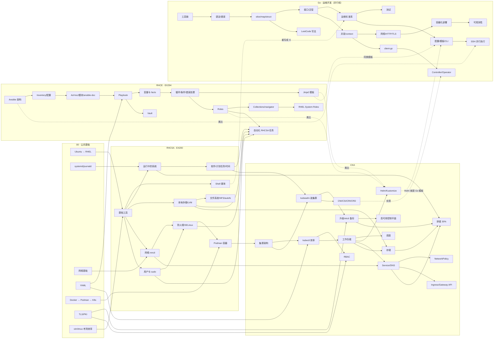

# 知识网络（notes/）

每篇笔记 = 知识网络里的一个节点。每篇顶部都写明：

- **前置**：学它之前最好先掌握的节点
- **后续**：学完之后自然衔接的节点
- **关联**：其他轨道里会复用这个知识的节点（比如 RHCSA 的 LVM ↔ RHCE 的存储自动化 ↔ CKA 的持久卷）
- **官方文档**：链接到 [`references/`](../references/) 里对应的离线官方文档

> 推荐用 [Obsidian](https://obsidian.md/) 打开整个仓库：笔记之间是标准 Markdown 相对链接，Obsidian 的「关系图谱」可以直接看到整张网络；在 GitHub 网页上点链接也能跳转。
> 新写笔记请复制 [`_template.md`](_template.md)。

## 全局地图

## 节点清单

### 00 · 公共基础（[`00-foundations/`](00-foundations/)）

| # | 笔记 | 一句话 |
|---|---|---|
| F1 | [Ubuntu → RHEL 对照](00-foundations/01-ubuntu-to-rhel.md) | apt→dnf、ufw→firewalld、AppArmor→SELinux、netplan→NetworkManager |
| F2 | [systemd 与 journald](00-foundations/02-systemd-journald.md) | 服务、target、日志——RHCSA 和 CKA 排错的共同底座 |
| F3 | [网络基础](00-foundations/03-networking-basics.md) | IP/掩码/路由/DNS/端口，后面 nmcli 和 K8s Service 都靠它 |
| F4 | [YAML 语法](00-foundations/04-yaml.md) | Ansible 和 Kubernetes 的共同语言 |
| F5 | [Docker → Podman → Kubernetes](00-foundations/05-containers-docker-to-k8s.md) | 把你的 docker/compose 经验迁移过来 |
| F6 | [TLS / PKI 基础](00-foundations/06-tls-pki-basics.md) | 证书、CA、kubeconfig 里的那串 base64 到底是什么 |
| F7 | [vim / tmux / 考场效率](00-foundations/07-vim-tmux-exam-efficiency.md) | 三门都是上机实操考试，手速就是分数 |

### RHCSA · EX200（[`rhcsa/`](rhcsa/README.md)）

| # | 笔记 | 考纲领域 |
|---|---|---|
| S1 | [基础工具](rhcsa/01-essential-tools.md) | Understand and use essential tools |
| S2 | [Shell 脚本](rhcsa/02-shell-scripting.md) | Create simple shell scripts |
| S3 | [运行中的系统](rhcsa/03-operate-running-systems.md) | Operate running systems |
| S4 | [本地存储与 LVM](rhcsa/04-local-storage-lvm.md) | Configure local storage |
| S5 | [文件系统 / NFS / autofs](rhcsa/05-file-systems-nfs-autofs.md) | Create and configure file systems |
| S6 | [软件、计划任务、时间、引导](rhcsa/06-software-scheduling-boot.md) | Deploy, configure, and maintain systems |
| S7 | [网络配置 nmcli](rhcsa/07-networking-nmcli.md) | Manage basic networking |
| S8 | [用户、组与 sudo](rhcsa/08-users-groups-sudo.md) | Manage users and groups |
| S9 | [防火墙与 SELinux](rhcsa/09-security-firewalld-selinux.md) | Manage security |
| S10 | [Podman 容器](rhcsa/10-containers-podman.md) | Manage containers（RHEL 9 版考纲；RHEL 10 版可能已移除，仍是通往 CKA 的桥） |

### RHCE · EX294（[`rhce/`](rhce/README.md)）

| # | 笔记 | 考纲领域 |
|---|---|---|
| E1 | [Ansible 架构与安装](rhce/01-ansible-architecture.md) | Understand core components / Install and configure a control node |
| E2 | [Inventory 与 ansible.cfg](rhce/02-inventory-and-config.md) | Control node / Managed nodes |
| E3 | [Ad-hoc、模块与 ansible-doc](rhce/03-adhoc-modules-docs.md) | Use provided documentation |
| E4 | [Playbook 基础](rhce/04-playbooks.md) | Create Ansible plays and playbooks |
| E5 | [变量与 facts](rhce/05-variables-facts.md) | Variables / Facts |
| E6 | [循环、条件、handler 与错误处理](rhce/06-loops-conditions-errors.md) | Loops / Conditionals / Handling task failure |
| E7 | [Jinja2 模板](rhce/07-jinja2-templates.md) | Manage content |
| E8 | [Roles](rhce/08-roles.md) | Use roles |
| E9 | [Collections 与 ansible-navigator](rhce/09-collections-navigator.md) | Content Collections / Automation content navigator |
| E10 | [Ansible Vault](rhce/10-vault.md) | Use Ansible Vault |
| E11 | [用 Ansible 自动化 RHCSA 任务](rhce/11-automate-rhcsa-tasks.md) | Automate standard RHCSA tasks（**连接 RHCSA 全部节点的枢纽**） |
| E12 | [RHEL System Roles](rhce/12-rhel-system-roles.md) | Use RHEL system roles / collections |

### CKA（[`cka/`](cka/README.md)）

| # | 笔记 | 考纲领域（权重） |
|---|---|---|
| K1 | [集群架构与组件](cka/01-architecture.md) | Cluster Architecture (25%) |
| K2 | [kubectl 高效操作](cka/02-kubectl-efficiency.md) | 全部领域的基本功 |
| K3 | [用 kubeadm 搭建集群](cka/03-kubeadm-install.md) | Cluster Architecture (25%) |
| K4 | [集群生命周期：升级与 etcd 备份恢复](cka/04-cluster-lifecycle.md) | Cluster Architecture (25%) |
| K5 | [高可用控制平面](cka/05-ha-control-plane.md) | Cluster Architecture (25%) |
| K6 | [RBAC 与 ServiceAccount](cka/06-rbac.md) | Cluster Architecture (25%) |
| K7 | [Helm 与 Kustomize](cka/07-helm-kustomize.md) | Cluster Architecture (25%) |
| K8 | [扩展接口：CNI/CSI/CRI、CRD 与 Operator](cka/08-extension-interfaces-crd.md) | Cluster Architecture (25%) |
| K9 | [工作负载：Deployment、ConfigMap/Secret、HPA](cka/09-workloads.md) | Workloads & Scheduling (15%) |
| K10 | [调度：资源、亲和性、污点](cka/10-scheduling.md) | Workloads & Scheduling (15%) |
| K11 | [Service 与 CoreDNS](cka/11-services-dns.md) | Services & Networking (20%) |
| K12 | [NetworkPolicy](cka/12-network-policy.md) | Services & Networking (20%) |
| K13 | [Ingress 与 Gateway API](cka/13-ingress-gateway-api.md) | Services & Networking (20%) |
| K14 | [存储：PV/PVC/StorageClass](cka/14-storage.md) | Storage (10%) |
| K15 | [排错](cka/15-troubleshooting.md) | Troubleshooting (30%) |

### Go · 运维开发（[`go/`](go/README.md)，和三门考试并行，每周 3~4 小时）

| # | 笔记 | 一句话 |
|---|---|---|
| G1 | [环境、模块与工具链](go/01-toolchain-modules.md) | `go mod`、交叉编译出静态二进制 |
| G2 | [基础语法与错误处理](go/02-basics-errors.md) | 变量、控制流、函数、`error` |
| G3 | [slice、map、struct 与指针](go/03-composite-types.md) | 运维数据最常用的三种结构 |
| G4 | [方法、接口与泛型](go/04-methods-interfaces-generics.md) | `io.Reader/Writer`，client-go 里到处是接口 |
| G5 | [运维常用标准库](go/05-stdlib-files-text-exec.md) | 文件、文本、正则、调用命令 |
| G6 | [测试与工程化](go/06-testing-tooling.md) | 表驱动测试、`-race`、项目布局 |
| G7 | [并发：goroutine、channel、context](go/07-concurrency-context.md) | worker pool、限并发、超时 |
| G8 | [网络、HTTP 与 TLS](go/08-net-http-tls.md) | 健康检查、证书过期检查 |
| G9 | [配置、模板与 CLI](go/09-config-template-cli.md) | YAML、`text/template`（Helm 同款）、cobra |
| G10 | [SSH 远程执行与并行任务](go/10-ssh-parallel-exec.md) | 一个迷你 Ansible |
| G11 | [容器化与在 K8s 上运行](go/11-containerize-deploy.md) | 多阶段构建、探针、优雅退出 |
| G12 | [client-go](go/12-client-go.md) | 用代码做 kubectl 做的事 |
| G13 | [Controller 与 Operator](go/13-controller-operator.md) | reconcile 循环、kubebuilder |
| G14 | [可观测性与 exporter](go/14-observability-exporter.md) | slog、Prometheus 指标 |
| G15 | [用 Go 刷 LeetCode](go/15-leetcode-in-go.md) | 堆、链表、并查集、BFS 模板 |
