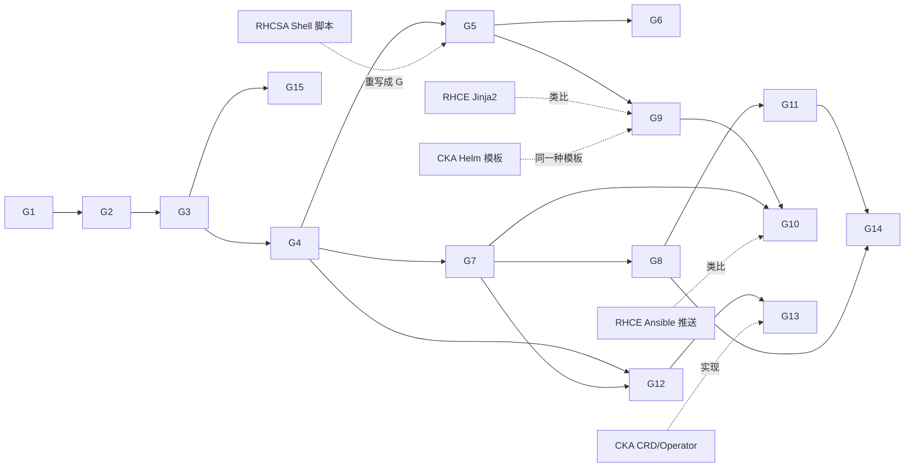

# Go 轨道：运维开发优先（notes/go/）

> **轨道**：Go ｜ **定位**：和 RHCSA → RHCE → CKA 并行的第四条线，不是考试科目 ｜ **节奏**：每周 3~4 小时，考试周暂停
>
> **怎么穿插**：每周学一个 Go 知识点 → 做 2~3 道 LeetCode（题目挑的是能对上运维场景的）→ 每隔一两周写一个「和本周考试内容相关」的运维小工具。

## 1. 为什么是 Go，为什么现在学

- Kubernetes、etcd、containerd、Prometheus、Helm、Terraform 都是 Go 写的。CKA 学到的每个组件，源码都是 Go。
- Go 编译出来是**单个静态二进制**：`scp` 到任何一台 RHEL 上就能跑，不用装解释器和依赖，这对运维工具非常友好。
- 运维开发（DevOps / SRE / 平台工程）岗位最常见的要求就是「Go + Kubernetes」：写 CLI 工具、exporter、controller / operator。
- 和考试互相促进：RHCSA 学的命令，用 Go 重写一遍就真正理解了；RHCE 的 Ansible 推送模型，用 Go 写一个并行 SSH 执行器就看透了；CKA 的 CRD / Operator，用 kubebuilder 写一个就不会忘。

## 2. 学习原则

1. **先能用，再深入**：前 4 周只学够写小工具的语法，别一上来啃语言规范。
2. **每个知识点都落到运维场景**：学 `bufio` 就去解析 `/var/log/secure`，学 goroutine 就去并发探测端口。
3. **LeetCode 是练手速和数据结构，不是目的**：每周 2~3 道，挑和运维场景对得上的（日志统计、依赖排序、限流、容量规划、网络图）。卡住 30 分钟就看题解，然后第二天重写一遍。
4. **所有代码都写测试**：从第 6 周起，项目和 LeetCode 都用表驱动测试（table-driven tests），这是 Go 社区的标准写法。

## 3. 知识节点

| # | 笔记 | 一句话 | 前置 | 跨轨道关联 |
|---|---|---|---|---|
| G1 | [环境、模块与工具链](01-toolchain-modules.md) | `go mod`、`go build/test/vet`、gofmt、交叉编译出静态二进制 | — | [F1](../00-foundations/01-ubuntu-to-rhel.md) |
| G2 | [基础语法与错误处理](02-basics-errors.md) | 变量、控制流、函数、`error` 与 `%w` 包装 | G1 | [S2 Shell 脚本](../rhcsa/02-shell-scripting.md) |
| G3 | [slice、map、struct 与指针](03-composite-types.md) | 运维数据（主机列表、计数表）最常用的三种结构 | G2 | — |
| G4 | [方法、接口与泛型](04-methods-interfaces-generics.md) | `io.Reader/Writer`、`fmt.Stringer`、client-go 里到处是接口 | G3 | [K12 client-go](12-client-go.md) |
| G5 | [运维常用标准库：文件、文本、命令](05-stdlib-files-text-exec.md) | `os`、`bufio`、`regexp`、`filepath`、`os/exec`、`encoding/json`、`flag` | G4 | [S1](../rhcsa/01-essential-tools.md)、[F2](../00-foundations/02-systemd-journald.md) |
| G6 | [测试与工程化](06-testing-tooling.md) | 表驱动测试、`-race`、基准测试、项目布局、Makefile | G5 | — |
| G7 | [并发：goroutine、channel、context](07-concurrency-context.md) | worker pool、限并发、超时取消、`errgroup` | G4 | [E1 Ansible forks](../rhce/01-ansible-architecture.md) |
| G8 | [网络、HTTP 与 TLS](08-net-http-tls.md) | `net.Dial`、HTTP 服务与客户端、健康检查、证书解析 | G7 | [S7](../rhcsa/07-networking-nmcli.md)、[F6](../00-foundations/06-tls-pki-basics.md) |
| G9 | [配置、模板与 CLI](09-config-template-cli.md) | YAML/JSON、`text/template`、cobra 命令行 | G5 | [E7 Jinja2](../rhce/07-jinja2-templates.md)、[K7 Helm](../cka/07-helm-kustomize.md)（Helm 模板就是 Go 模板） |
| G10 | [SSH 远程执行与并行任务](10-ssh-parallel-exec.md) | `x/crypto/ssh` + 并发 = 一个迷你 Ansible | G7、G9 | [E1](../rhce/01-ansible-architecture.md)、[E3](../rhce/03-adhoc-modules-docs.md) |
| G11 | [容器化与在 K8s 上运行 Go 服务](11-containerize-deploy.md) | 多阶段构建、distroless、探针、优雅退出 | G8 | [F5](../00-foundations/05-containers-docker-to-k8s.md)、[K9](../cka/09-workloads.md) |
| G12 | [client-go：用代码操作 Kubernetes](12-client-go.md) | kubeconfig、clientset、list/watch、informer | G4、G7 | [K1](../cka/01-architecture.md)、[K2](../cka/02-kubectl-efficiency.md)、[K15](../cka/15-troubleshooting.md) |
| G13 | [Controller 与 Operator](13-controller-operator.md) | reconcile 循环、controller-runtime、kubebuilder | G12 | [K8 CRD / Operator](../cka/08-extension-interfaces-crd.md) |
| G14 | [可观测性：日志、指标与 exporter](14-observability-exporter.md) | `log/slog`、Prometheus client_golang、自定义 exporter | G8、G11 | [K15](../cka/15-troubleshooting.md) |
| G15 | [用 Go 刷 LeetCode](15-leetcode-in-go.md) | `container/heap`、`container/list`、`slices`、并查集、BFS 模板 | G3 | — |

## 4. 每周穿插表（和 24 周路线同一张时间轴）

> 题号对应 [LeetCode 刷题计划](../../labs/go/leetcode-plan.md)，项目对应 [运维小项目](../../labs/go/projects.md)。🔒 = LeetCode 会员题，可选。

| 周 | 考试阶段 | Go 知识点 | LeetCode | 运维小项目 |
|---|---|---|---|---|
| W1 | 准备 | [G1](01-toolchain-modules.md) | 1、1108 | 装好 Go，写第一个 CLI：打印主机名、内核版本、uptime |
| W2 | 准备 | [G2](02-basics-errors.md) | 20、14、929 | — |
| W3 | RHCSA | [G3](03-composite-types.md) | 49、347、811 | — |
| W4 | RHCSA | [G4](04-methods-interfaces-generics.md) | 155、232、706 | — |
| W5 | RHCSA | [G5](05-stdlib-files-text-exec.md) | 71、609、692 | **P1 logstat**：统计 SSH 登录失败的 IP |
| W6 | RHCSA | [G6](06-testing-tooling.md) | 165、468、8 | **P2 fstab-lint**：检查 /etc/fstab |
| W7 | RHCSA | G5 复习 | 56、57、435 | **P3 svcwatch**：批量检查 systemd 服务 |
| W8 | RHCSA | （SELinux 周，Go 减量） | 704、278 | — |
| W9 | RHCSA | [G7](07-concurrency-context.md) | 1114、622、239 | **P4 portcheck**：并发端口探测 |
| W10 | **EX200** | 暂停 | — | — |
| W11 | RHCE | [G9](09-config-template-cli.md) | 394、150、224 | — |
| W12 | RHCE | G9 复习 | 146、981 | **P5 tmplgen**：YAML 变量 + 模板生成配置，幂等写入 |
| W13 | RHCE | [G10](10-ssh-parallel-exec.md) | 21、23、215 | **P6 gossh**：并行 SSH 执行器（迷你 Ansible） |
| W14 | RHCE | [G15](15-leetcode-in-go.md) | 207、210、621 | **P7 depsort**：服务依赖拓扑排序 |
| W15 | RHCE | [G8](08-net-http-tls.md) | 3、295、703 | **P8 certcheck**：批量检查证书过期时间 |
| W16 | **EX294** | 暂停 | — | — |
| W17 | CKA | [G11](11-containerize-deploy.md) | 200、994、102 | 把 P8 改成 HTTP 服务，容器化并部署到 kind，配探针 |
| W18 | CKA | [G12](12-client-go.md) | 380、528 | **P9 kpods**：列出所有不健康的 Pod 和原因 |
| W19 | CKA | G12 watch / informer | 743、547、684 | P9 加 watch 模式 |
| W20 | CKA | [G14](14-observability-exporter.md) | 1192、1584 | **P10 cert-exporter**：证书过期天数的 Prometheus exporter |
| W21 | CKA | [G13](13-controller-operator.md) | 875、1011 | 读 sample-controller 源码 |
| W22 | CKA | G13 kubebuilder | 1396、1472、460 | **P11 operator**：用 kubebuilder 写一个 CRD + controller |
| W23 | CKA | 复习 | 72、1143 | 整理 11 个项目的 README，放到 GitHub 上 |
| W24 | **CKA** | 暂停 | — | — |

会员题（可选）：🔒359 日志速率限制器、🔒362 敲击计数器、🔒588 设计内存文件系统、🔒1166 设计文件系统、🔒253 会议室 II。

## 5. 资料地图（本仓库离线版）

| 资料 | 位置 | 什么时候用 |
|---|---|---|
| Tour of Go（官方交互教程原文） | [`references/go/tour/`](../../references/go/tour/) | W1~W4，配合 `go install golang.org/x/website/tour@latest` 本地运行 |
| 官方教程、Effective Go、FAQ、模块文档 | [`references/go/go-docs/`](../../references/go/go-docs/) | 贯穿全程；W1 先读 `tutorial/getting-started.html`、`code.html` |
| 语言规范、内存模型 | [`references/go/spec/`](../../references/go/spec/) | 遇到语法疑问时查；G7 并发时读内存模型 |
| Go by Example（社区经典，CC BY 3.0） | [`references/go/gobyexample/`](../../references/go/gobyexample/) | 需要某个标准库用法的最小示例时 |
| cobra 文档 | [`references/go/cobra-docs/`](../../references/go/cobra-docs/) | G9 写 CLI |
| client-go 官方示例 | [`references/go/k8s/client-go-examples/`](../../references/go/k8s/client-go-examples/) | G12 |
| sample-controller（官方示例控制器） | [`references/go/k8s/sample-controller/`](../../references/go/k8s/sample-controller/) | G13 |
| Kubebuilder Book | [`references/go/k8s/kubebuilder-book/`](../../references/go/k8s/kubebuilder-book/) | G13 |
| Prometheus client_golang 示例 | [`references/go/prometheus-client-golang-examples/`](../../references/go/prometheus-client-golang-examples/) | G14 |

本机随时可查的文档：`go doc fmt.Printf`、`go doc -all net/http | less`、`go help modules`。在线：pkg.go.dev。

## 6. 动手

- 环境搭建：[`labs/go/00-setup.md`](../../labs/go/00-setup.md)
- 11 个运维小项目：[`labs/go/projects.md`](../../labs/go/projects.md)
- LeetCode 刷题计划：[`labs/go/leetcode-plan.md`](../../labs/go/leetcode-plan.md)
- 代码放在仓库的 [`go/`](../../go/) 目录（一个 Go module）：`go/leetcode/` 放题解，`go/tools/` 放项目。
