# RHCSA · EX200 轨道索引

> **定位**：RHCSA（Red Hat Certified System Administrator）是红帽认证体系的地基，也是 **RHCE 的前置条件**——RHCE 的 EX294 考的就是「用 Ansible 把 RHCSA 的活自动化」。
> 这条轨道学扎实了，RHCE 只是换个写法，CKA 的排错（30%）也会轻松很多。
>
> **上级**：[知识网络总览](../README.md) ｜ **下游轨道**：[RHCE · EX294](../rhce/README.md) · [CKA](../cka/README.md)

## 1. 考试速览

| 项目 | 内容 |
|---|---|
| 考试代码 | EX200 |
| 版本 | 当前基于 **RHEL 10**（第三方资料与红帽课程页均指向 RHEL 10；报名时可能仍可选 RHEL 9 版，**以官方为准**） |
| 形式 | 上机实操（performance-based），在真实虚拟机上完成任务，按「最终系统状态」自动评分 |
| 时长 | 约 3 小时（以官方为准）；据公开资料满分 300、210 分通过 |
| 考场文档 | **只能用考试机本地的文档**：`man`、`info`、`--help`、`/usr/share/doc`。没有浏览器、没有搜索引擎 |
| 核心原则 | **所有配置必须重启后仍生效**——评分前机器会被重启，临时生效的配置等于没做 |
| 证书关系 | RHCSA 有效期内通过 EX294 → 获得 RHCE |

> **2026-05 认证体系改版提示**：红帽在 2026 年 5 月把认证重组为多条专业路径（Enterprise Linux / Ansible / OpenShift 等），EX294 的官方标题也随之变化。
> 具体的路径名称、前置要求、考纲细节，请在报名前核对官方页面：
> <https://www.redhat.com/en/services/training/ex200-red-hat-certified-system-administrator-rhcsa-exam>

## 2. 考纲领域 → 笔记映射

考纲条目基于大家熟悉的 RHEL 9 版 EX200 结构整理；RHEL 10 的变化用 ⚠️ 标出，**来源不确定的一律以官方页面为准**。

| 考纲领域（英文原名） | 主要考点 | 笔记 |
|---|---|---|
| Understand and use essential tools | shell、重定向、grep/正则、SSH、tar、链接、ugo/rwx 权限、man//usr/share/doc | [S1 基础工具](01-essential-tools.md) |
| Create simple shell scripts | if/test、for/while、`$1 $#`、命令替换 | [S2 Shell 脚本](02-shell-scripting.md) |
| Operate running systems | 开关机、切换 target、**中断引导重置 root 密码**、进程/nice、tuned、日志与持久化 journal、scp/rsync | [S3 运行中的系统](03-operate-running-systems.md) |
| Configure local storage | MBR/GPT 分区、PV/VG/LV、按 UUID/LABEL 挂载、非破坏性地新增分区/LV/swap | [S4 本地存储与 LVM](04-local-storage-lvm.md) |
| Create and configure file systems | vfat/ext4/xfs、NFS、autofs、扩容 LV、set-GID 协作目录、权限排错 | [S5 文件系统 / NFS / autofs](05-file-systems-nfs-autofs.md) |
| Deploy, configure, and maintain systems | at/cron、服务开机自启、默认 target、chrony、dnf 仓库与软件包、修改引导参数 | [S6 软件、计划任务、时间、引导](06-software-scheduling-boot.md) |
| ⚠️ Manage software（RHEL 10 新增） | 配置 **Flatpak** 仓库、安装/删除 Flatpak 应用（据红帽 EX200 页面搜索摘要，以官方为准） | [S6](06-software-scheduling-boot.md) |
| Manage basic networking | IPv4/IPv6、主机名解析、网络服务开机启动、防火墙限制访问 | [S7 网络配置 nmcli](07-networking-nmcli.md) |
| Manage users and groups | 用户/组增删改、密码策略 chage、sudo 提权 | [S8 用户、组与 sudo](08-users-groups-sudo.md) |
| Manage security | firewalld、umask、SSH 密钥登录、SELinux 模式/上下文/端口/布尔值/排错 | [S9 防火墙与 SELinux](09-security-firewalld-selinux.md) |
| ⚠️ Manage containers（RHEL 9 版） | podman/skopeo、Containerfile、容器作为 systemd 服务、持久存储 | [S10 Podman 容器](10-containers-podman.md) |

> ⚠️ 关于容器：有第三方培训机构称 RHEL 10 版 EX200 **已移除**容器相关目标（未能从红帽官方页面核实）。
> 不管考不考，S10 都建议学——它是从 Docker 经验走向 [CKA](../cka/README.md) 的桥梁。

## 3. 建议学习顺序与用时

按每周 10~15 小时估算，RHCSA 整体约 **6~8 周**。

| 周 | 内容 | 产出 |
|---|---|---|
| 第 0 周 | [搭实验环境](../../labs/rhcsa/00-lab-setup.md)：2 台 RHEL 10 VM + 额外磁盘 + 本地仓库 + 快照 | 能随时回滚的实验室 |
| 第 1 周 | [S1](01-essential-tools.md) → [S2](02-shell-scripting.md) | 能写 20 行以内的小脚本 |
| 第 2 周 | [S3](03-operate-running-systems.md) → [S6](06-software-scheduling-boot.md) | 闭着眼睛重置 root 密码 |
| 第 3 周 | [S4](04-local-storage-lvm.md) → [S5](05-file-systems-nfs-autofs.md) | LVM 扩容、autofs 一次成功 |
| 第 4 周 | [S7](07-networking-nmcli.md) → [S8](08-users-groups-sudo.md) | nmcli 改静态 IP 不断网 |
| 第 5 周 | [S9](09-security-firewalld-selinux.md) | SELinux 报错能自己定位 |
| 第 6 周 | [S10](10-containers-podman.md) + [练习题集](../../labs/rhcsa/practice-set-1.md) 全刷 | 40+ 题过一遍 |
| 第 7~8 周 | [模拟考](../../labs/rhcsa/mock-exam.md) 计时 2~3 次、查漏补缺 | 稳定 2.5 小时内完成 |

学习方法建议：

1. **先在 VM 上做，再看笔记**——上机考试拼的是肌肉记忆。
2. 每个知识点都要做一遍「重启验证」：`reboot` 后检查配置还在不在。
3. 练习时**禁用搜索引擎**，只用 `man`、`--help`、`/usr/share/doc`，提前适应考场。
4. 每次做错的题记到 [`journal/`](../../journal/) 的错题本里。

## 4. 和其他轨道的衔接

```mermaid
flowchart LR
  S1[S1 基础工具] --> S2[S2 Shell 脚本] --> E11[RHCE-11 自动化 RHCSA 任务]
  S4[S4 LVM] --> E11
  S6[S6 软件/计划任务] --> E11
  S8[S8 用户与 sudo] --> E11
  S9[S9 防火墙/SELinux] --> E11
  S4 --> K14[CKA-14 存储]
  S7[S7 网络] --> K11[CKA-11 Service/DNS]
  S3[S3 运行中的系统] --> K15[CKA-15 排错]
  S6 --> K3[CKA-03 kubeadm 装集群]
  S10[S10 Podman] --> K1[CKA-01 集群架构]
```

- **→ RHCE**：RHCE 的每个「自动化 RHCSA 任务」都要求你先知道手工怎么做。比如 `ansible.builtin.lvol` 的参数和 `lvcreate` 一一对应。见 [RHCE-11](../rhce/11-automate-rhcsa-tasks.md)。
- **→ CKA**：kubeadm 装集群前要关 swap、加载内核模块、配 sysctl、放行防火墙端口（[CKA-03](../cka/03-kubeadm-install.md)）；节点 NotReady 时第一件事是 `systemctl status kubelet` + `journalctl -u kubelet`（[CKA-15](../cka/15-troubleshooting.md)）。

## 5. 官方资料

- 官方考纲页（报名前必看）：<https://www.redhat.com/en/services/training/ex200-red-hat-certified-system-administrator-rhcsa-exam>
- RHEL 10 文档首页：<https://docs.redhat.com/en/documentation/red_hat_enterprise_linux/10>
- 离线 PDF：在自己电脑上运行 [`scripts/fetch-rhel-docs.sh`](../../scripts/fetch-rhel-docs.sh)，下载到 `references/rhel/10/`
- 资料总表：[`references/README.md`](../../references/README.md)
